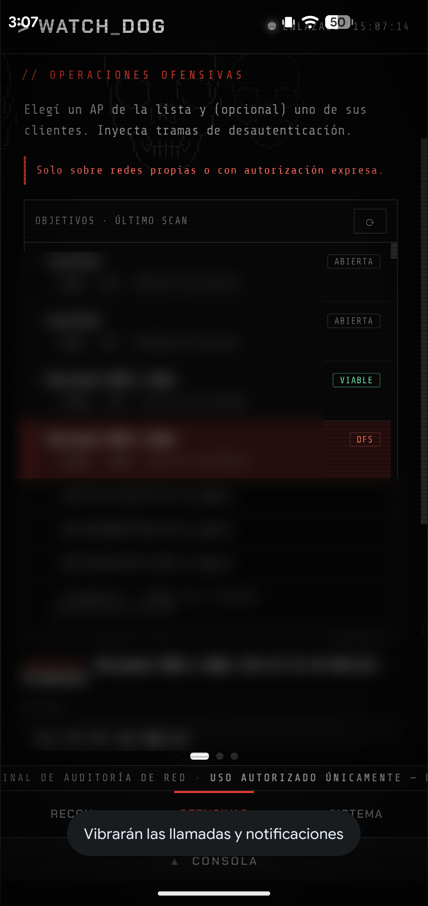
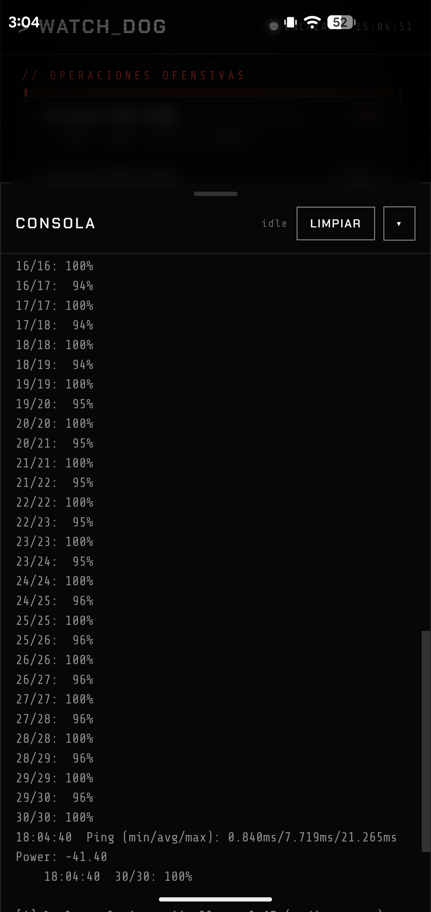

<div align="center">


# WATCHDOG

**Teléfono de auditoría de redes inspirado en Watch Dogs. Reconocimiento y pentesting WiFi desde un Samsung Galaxy S10 con Kali NetHunter, operado desde una interfaz web que corre 100% local y sin internet.**


</div>

> **Uso autorizado únicamente.** Herramienta para auditar redes y dispositivos **propios o con autorización explícita**. El uso sobre redes ajenas sin permiso es ilegal en la mayoría de las jurisdicciones. Los autores no se responsabilizan por el mal uso.

<div align="center">
<table>
<tr>
<td align="center" width="50%"><br><sub><b>Selección de objetivos</b> — semáforo de viabilidad (PMF / DFS)</sub></td>
<td align="center" width="50%"><br><sub><b>Consola en vivo</b> — test de inyección al 100%</sub></td>
</tr>
</table>
</div>

---

## El proyecto

WATCHDOG convierte un teléfono con Kali NetHunter en una herramienta de auditoría de red portátil y autosuficiente. Un servidor Flask corre dentro del chroot de Kali y ejecuta las herramientas reales (aircrack-ng, nmap, hostapd, wifite) sobre una antena WiFi externa; la interfaz es una web con estética Watch Dogs que se sirve en `localhost`, se instala como aplicación a pantalla completa y funciona en modo avión.

El motor vive en Kali —el único lugar con root y acceso a la antena en modo monitor— y la interfaz es siempre un control remoto local de ese backend. La premisa de diseño es que el aparato cumpla su objetivo **sin depender de ninguna red externa**.

---

## Qué hace

| Capacidad | Detalle | Estado |
|---|---|---|
| Reconocimiento WiFi | Redes en 2.4 y 5 GHz: señal, canal, seguridad y clientes | Funcional |
| Escaneo de red | Hosts, puertos y versiones de servicios (nmap) | Funcional |
| Deauth | Desautenticación dirigida, fijando el canal del objetivo | Confirmado en hardware |
| Evil twin / Wifite | AP falso (hostapd) y auditoría automatizada de handshakes | En desarrollo |
| Semáforo de viabilidad | Marca por objetivo si el ataque es viable: detecta **PMF/802.11w** y canales **DFS**, más un **test de inyección** real | Funcional |
| Antena automática | Se prepara en monitor al operar y queda en **reposo** (radio apagada) al terminar; botón de recuperación sin reiniciar el teléfono | Funcional |
| 100% offline | Todo local en `localhost`, sin requests a internet; PWA instalable | Funcional |

---

## Arquitectura

El trabajo pesado corre como root dentro del chroot de Kali, sobre una antena externa **RTL8812AU** (`wlan2`, modo monitor + inyección). La interfaz web solo habla con ese backend por HTTP y SSE. El WiFi interno del teléfono no se toca.

```
┌───────────────────────── Samsung Galaxy S10 ─────────────────────────┐
│                                                                       │
│   PWA (WebView, localhost:5001)  ⇄  Servidor Flask (chroot Kali)      │
│   offline · instalable                 app.py + módulos               │
│                                              │                        │
│                                   nmap · aircrack-ng · hostapd        │
│                                   dnsmasq · wifite · iw               │
│                                              │ USB-OTG                 │
│                                   Antena externa RTL8812AU (wlan2)     │
└───────────────────────────────────────────────────────────────────────┘
```

```
smartphone-hacking-tool/
├── server/
│   ├── app.py                # orquestador Flask (puerto 5001)
│   ├── modules/              # network.py, wifi_scan.py, (stubs a futuro)
│   ├── static/               # PWA: fuentes, iconos, manifest, service worker
│   └── templates/index.html  # interfaz Watch Dogs
├── scripts/
│   ├── setup.sh              # instalador de dependencias
│   └── kali-scripts/         # antenna.sh, check_deps.sh, wifi_*.sh (corren en Kali)
└── docs/                     # REQUIREMENTS.md (SRS), setup.md
```

---

## Instalación

Dentro del chroot de Kali, como root:

```bash
cd /root/watchdog-git
bash scripts/setup.sh          # instala/actualiza dependencias (requiere internet solo acá)
cd server && python3 app.py    # sirve la interfaz en localhost:5001
```

Luego se abre `http://localhost:5001` en el navegador del teléfono. Para instalarla como app a pantalla completa (incluso en teléfonos de-Googled, sin Google Play Services), la guía completa está en [`docs/setup.md`](docs/setup.md).

---

## Estado y roadmap

El proyecto avanza por milestones. Detalle y requerimientos en [`docs/REQUIREMENTS.md`](docs/REQUIREMENTS.md).

| Milestone | Contenido | Estado |
|---|---|---|
| M1 | PWA + offline total (fuentes embebidas, service worker, instalable) | Completado |
| M2 | Core ofensivo confiable (antena automática, semáforo PMF/DFS, deauth confirmado) | En curso |
| M3 | Core defensivo (WIDS: evil twins, deauth floods, rogue APs) | Pendiente |
| M4 | Módulos restantes (Bluetooth, NFC, HID) + motor de decisión | Pendiente |
| M5 | Portabilidad a varios dispositivos NetHunter | Pendiente |

---

## Stack

Python · Flask · HTML/CSS/JS (PWA, service worker, SSE) · aircrack-ng · nmap · hostapd · dnsmasq · wifite · iw.
Hardware: Samsung Galaxy S10 con Kali NetHunter + antena RTL8812AU.

---

## Autor

**Tomás Uriel Salinas** (Tata-14Dev)

- GitHub: [Tata-14Dev](https://github.com/Tata-14Dev)
- LinkedIn: [tomas-uriel-salinas](https://www.linkedin.com/in/tomas-uriel-salinas-353b782a8)
- Email: [tomassalinas.u@hotmail.com](mailto:tomassalinas.u@hotmail.com)

---

<div align="center">
<sub>Proyecto de investigación en seguridad. Úsese de forma ética y legal, solo sobre infraestructura propia o con autorización escrita.</sub>
</div>
